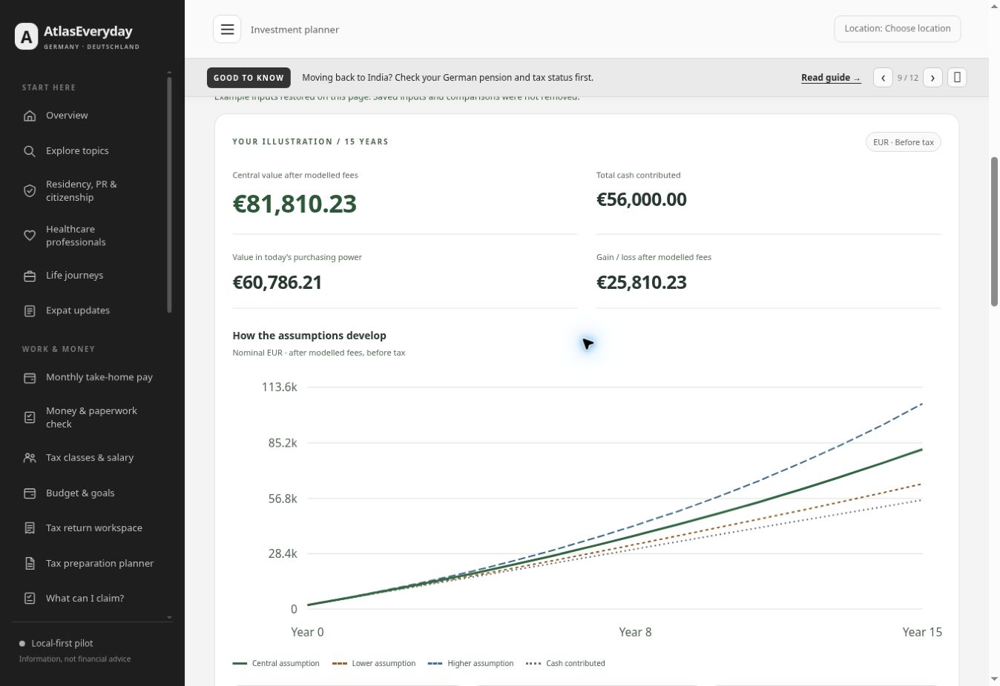

# Expanded investment and savings planner — 13 November 2026

## Delivered scope

The four-input growth explorer is replaced by a planner with initial/monthly contributions, fixed year-end top-ups, annual changes to monthly contributions, deposit timing, ongoing balance fees, percentage charges on deposits, inflation and three growth assumptions. It also calculates a starting monthly amount for a savings goal, including a goal stated in today’s purchasing power.

Visitors can plan in EUR or INR and optionally enter an INR-per-EUR quote for the final value. The page provides a growth chart, year-by-year figures, CSV export, explicit browser-local saving of inputs and up to three comparisons, and explainers for eight investment groups. Search and the existing topic hubs link to the expanded planner. Local JSON backups include its saved records.

## Publication evidence

- Feature commit: `ee7a986614b5718b4831f26432485d4353e6ffa4`.
- [Pages run 43434520467](https://github.com/nikunjsb/Finbridge/actions/runs/43434520467): successful deployment at **14:33 CET**, 13 November 2026.
- Public route: https://nikunjsb.github.io/Finbridge/#invest.
- The public browser loaded build `016a06250c43` and app `1e34fe4312d9`.
- Live fixtures reproduced **1,120.00 EUR** for 1,000 at 12% effective annual growth over one year, **1,089.00 EUR** for 10% growth with a 1% annual ongoing fee, and **1,000.00 EUR** when converting a 95,000 INR final value at a manually entered 95 INR/EUR.

## Model conventions

Growth is an effective annual rate converted into twelve equal monthly factors. The annual ongoing fee is separately converted into a monthly balance-charge factor. Their annual combined factor is `(1 + growth) × (1 − ongoing fee)`. Charges on new contributions reduce each deposit. Monthly deposits can arrive at the beginning or end of the period; additional annual contributions always arrive at year-end. The annual contribution change starts with year two and affects the monthly deposits only.

Purchasing power divides the final balance by compounded inflation in the plan currency. The goal solver preserves the central growth, fees, top-ups and annual contribution change, and rounds the required starting monthly contribution up to cents. Fee impact compares otherwise identical paths with and without the modelled fees; it is distinct from the actual sum paid in fees. Manual currency conversion applies at the horizon only.

The previous `investmentProjection` helper and its nominal-rate tests remain for compatibility, but the expanded page uses the new effective-annual model. Its results should not be interpreted using the earlier nominal-rate convention.

## Validation

All **91 local tests** passed, including **27 new investment tests**. The new checks use independently evaluated closed-form/manual cases for compound growth, ordinary/due annuities, annual top-ups, fee factors, inflation, negative growth, contribution changes, goals and currency conversion. They also cover invalid/non-finite imported fields, amount limits, non-mutation of inputs, year-row accounting, escaped text and formula-safe CSV names. Syntax, asset-version and whitespace checks passed.

Browser checks covered:

- Desktop and **900px**, **390px** and **320px** layouts without page overflow. The yearly table scrolls within its own region on narrow screens; chart labels and small-screen result layout were checked.
- Reference calculations for effective annual growth and combined ongoing fees; a two-year contribution/top-up case produced **27,200 EUR**, matching the goal and a **1,000 EUR** starting monthly amount.
- A 100,000 EUR goal in today’s money became **134,586.83 EUR** after fifteen years at the illustrative 2% inflation assumption.
- EUR/INR direction, explicit manual quote entry and goal-result updates.
- Save/reload, loading a saved comparison, retaining three separate plans, and enforcing the three-plan limit in the preview. Production verification did not save these QA records.
- A downloaded CSV matched the visible 1,120 EUR fixture and contained the assumptions and both year rows. A local JSON backup included the saved INR inputs and all three synthetic comparisons.
- Specific input errors blocked saving; section-jump controls focused the destination. Search for “investment fees” opened the expanded planner.
- No application-origin errors were observed in the checked preview logs.

## Sources and limits

Concept references reviewed on 13 November 2026:

- [Investor.gov compound-interest calculator](https://www.investor.gov/financial-tools-calculators/calculators/compound-interest-calculator).
- [Investor.gov investment fee explanation](https://www.investor.gov/introduction-investing/general-resources/news-alerts/alerts-bulletins/investor-bulletins/updated).
- [Investor.gov risk, inflation and currency information](https://www.investor.gov/introduction-investing/investing-basics/what-risk).
- [BaFin principles of investing](https://www.bafin.de/DE/Verbraucher/GeldanlageWertpapiere/Grundregeln_der_Geldanlage/Grundregeln_der_Geldanlage_node.html).
- [SEBI Investor mutual-fund explanation](https://investor.sebi.gov.in/understanding_mf.html).

These sources explain the concepts and do not endorse this calculator or its assumptions. The scenarios are constant-growth, before-tax illustrations rather than forecasts or probability/loss bounds. The model excludes changing market paths, withdrawals, taxes, pension benefits, property financing, fixed trading costs and currency conversion on individual contributions. Its quote and return fields are user assumptions, with no live feed or product-return presets. Invalid or extreme inputs outside the supported ranges are rejected, including calculated amounts above one trillion units.

The wider Sunday accessibility/performance and authenticated Cloudflare checks, Friday security work and hosting review retain their existing pending status and dates.

## Published example view

