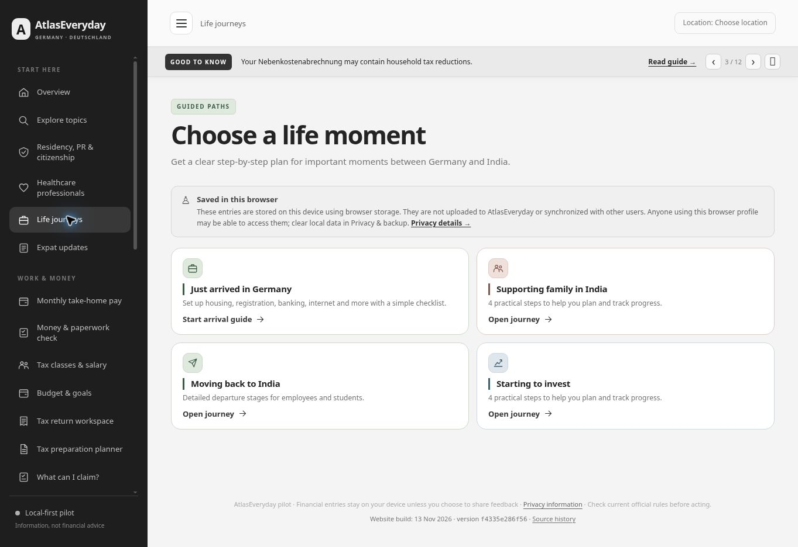

# Shared page colour accents — 13 November 2026

The owner asked to extend the small colours from Overview to the rest of AtlasEveryday. The existing sage, sand, blue and rose palette now accents inner-page cards, icon badges, labels, secondary links, selected tax categories and focus outlines. White card surfaces, dark primary buttons and the existing overview/topic layouts retain their appearance.

`page-accents.js` assigns whitelisted presentation attributes from the current route, existing topic metadata and individual card destinations. Mixed pages retain different relevant card colours. Arrival/departure checklist icons also use the palette; checked steps retain the existing completion style. Alert/error/warning/success cards are excluded from the new card treatment. The module adds no requests, storage, calculators or financial assumptions.

## Publication evidence

- Feature commit: [`fd28c8bb98e84c0d802f4bb1dde7d6e5c42da8ed`](https://github.com/nikunjsb/Finbridge/commit/fd28c8bb98e84c0d802f4bb1dde7d6e5c42da8ed).
- [Pages run 43439913699](https://github.com/nikunjsb/Finbridge/actions/runs/43439913699): completed successfully; deploy job finished **14:09:15 UTC / 15:09:15 CET**.
- Normal reload of the public site served build **`f4335e286f56`**, app **`049d43d4a783`**, CSS **`14493cfdcb23`**. No cache-busting query was added to the page URL.
- Live checks covered salary, healthcare access, Language Bridge, Germany–India, Explore, tax workspace and investment planner. Their rendered route attributes and computed palette colours matched the preview; no page overflow was observed at the desktop viewport.
- The final public Life journeys page visibly showed sage arrival/return cards, rose family support and blue investment accents. The screenshot contains static guidance and no entered financial records.

## Validation

- All **91 existing tests** passed: investment planning, money guidance, services and tax planning. No calculator/model/service implementation changed.
- Asset version check, JavaScript syntax checks and `git diff --check` passed.
- Preview navigation covered every sidebar page, plus arrival/return checklists, representative guides, tax subsections, a topic hub and Overview. Overview/topic pages were confirmed to keep their original treatment.
- Responsive previews at **320, 390 and 900 CSS pixels** covered Explore, journeys, tax workspace, investment, healthcare, Language Bridge, insurance checks and news. Each document's scroll width matched its client width; screenshots showed readable wrapping and stacked cards. These were browser iframes at the stated widths, not physical-device tests.
- Selecting Insurance retained `aria-pressed="true"`, with the rose pale background, border and selection ring. Keyboard movement to the next category showed a visible 3px focus outline. Unsaved category selection was used; no expense record was created.
- All four dark accent text / tinted background pairs exceed the **4.5:1** normal-text contrast threshold:

| Accent | Text | Tint | Contrast |
|---|---|---|---|
| Sage | `#395d43` | `#dfe9dd` | 5.97:1 |
| Sand | `#775d34` | `#eee4d4` | 4.91:1 |
| Blue | `#3c6073` | `#dfe7ec` | 5.39:1 |
| Rose | `#81574b` | `#efe0dc` | 4.82:1 |

This completes checklist item **22**. These are focused release checks; the broader accessibility/performance audit and authenticated Cloudflare verification remain scheduled for **15 November**, security for **20 November**, and the hosting/domain review for **22 November 2026**.
