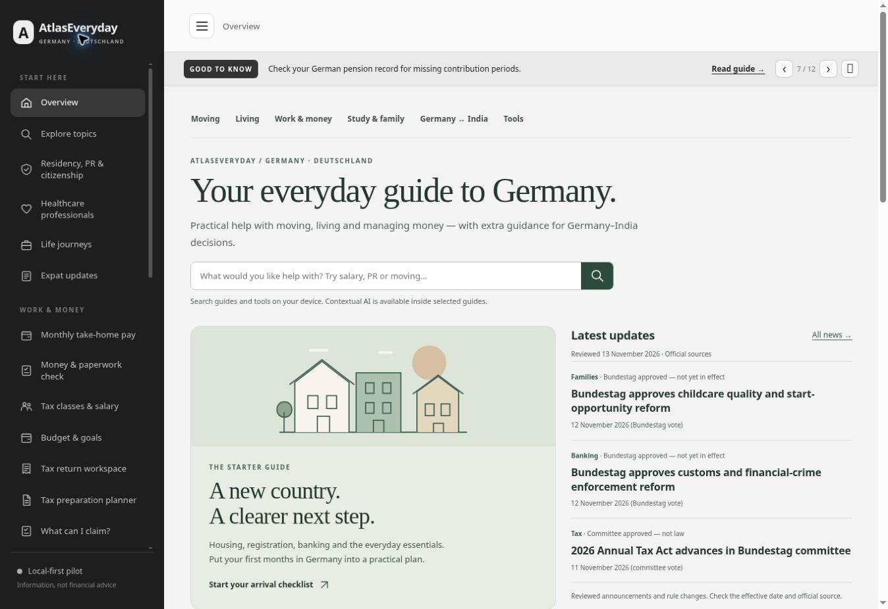

# AtlasEveryday homepage and topic organization — 13 November 2026

## Published result

The homepage now organizes the existing content into a featured arrival guide, reviewed updates, four life stages, six topic hubs, practical tools and editorial guide recommendations. The hubs cover moving, living, work and money, study and family, Germany–India decisions, and calculators/checklists. Each combines an introduction, suggested steps, existing guide cards, relevant tools and official starting points. Search includes the hubs, and homepage headlines link to their corresponding news items.

The layout uses the AtlasEveryday identity, the existing app navigation and new inline SVG illustrations. Calculators, article content, saved-data keys and the separate service endpoints retain their existing behavior.

## Publication evidence

- Feature commit: `1b604400aede4851c641556f15ad3668971e5530`.
- [Pages run 43414847487](https://github.com/nikunjsb/Finbridge/actions/runs/43414847487): completed successfully at **12:11 CET**, 13 November 2026.
- Existing public destination: https://nikunjsb.github.io/Finbridge/#overview.
- Normal reload served website build `0a1bb9db1f19`, app `0a46144324db` and the new portal module.

## Verification completed

- All **64 existing tests** passed. Syntax, asset versions and whitespace checks passed.
- All six topic hubs rendered; **141 internal hub links** resolved to existing routes and articles. Unknown topic fallback and escaping of source text were checked with synthetic inputs.
- Browser checks at **1363px** desktop, **900px** compact desktop, **390px** and **320px** mobile widths. The home had no page overflow at those widths; all six hubs had no page overflow at 1363px, 390px and 320px.
- Keyboard Tab/Enter navigation through the topic links worked. Hub breadcrumbs, active category and official-source sections were present.
- Homepage salary search opened the existing salary calculator; library search returned the Moving hub.
- Specific news links opened the matching news item and its official-source link. The selected article scrolled into view.
- On the public website, a normal reload displayed the matching build, six hubs, four stages and three reviewed updates. All six hubs, salary search and a specific news link were checked again live.
- No application-origin browser errors were observed in the preview check. Browser extension metadata errors were excluded from that application finding.

These are checks for the bounded presentation/navigation release. Full-site regression, wider accessibility/performance checks, authenticated Cloudflare verification and the scheduled security work keep their existing pending status and dates.

## Live homepage view

