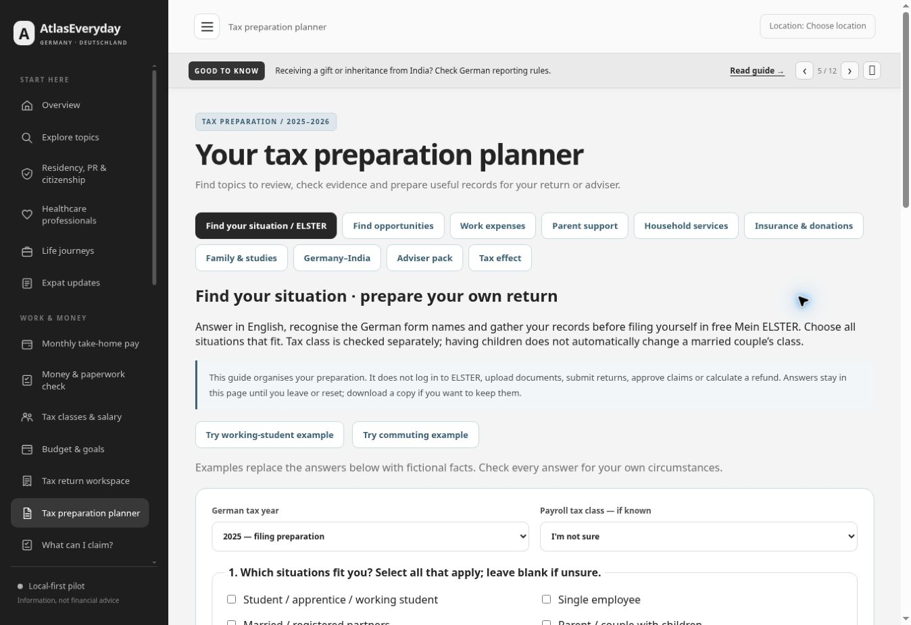

# English self-filing companion — 14 November 2026

## Implemented scope

- `#taxplan/prepare`: 13 overlapping situations, tax year/class checked separately, year-change questions, unknown-answer paths, employment/education/residence and optional second-household questions.
- Two fictional, editable example journeys: working student and commuting employee with work accommodation. Selection does not establish eligibility or guarantee a refund. Other situations show their preparation coverage and existing relevant routes; business, pension, bereavement and cross-border assessment are explicitly bounded.
- German section names beside English document guidance, free ELSTER/prefilled-data preparation, next steps through self-submission and checking the notice. No ELSTER access, credentials, document upload or transmission integration.
- A browser-local TXT preparation-plan download. Changing inputs invalidates the result/download; resetting clears the answers; navigation/reload does not persist this questionnaire. Existing expense ledger and saved worksheets are untouched.
- Optional future investment contribution budget, horizon and accessibility preference; comparison requirements are specified in [INVESTMENT_TAX_COMPARISON_SPEC.md](../INVESTMENT_TAX_COMPARISON_SPEC.md). No automatic allocation, refund or investment-tax calculation is shipped.

## Sources and year limits

Official ELSTER private-person and certificate-retrieval pages, ELSTER 2025 education/employment help, EStG §§9/10/24b and Minijob-Zentrale tax guidance were consulted. Source links are available on the page. Existing yearly models keep their stated scope.

2025 has filing-preparation guidance; 2026 remains in-year preparation. Final 2026 forms/field mappings are not verified. No line numbers are asserted. The student route distinguishes initial education from subsequent/training-employment education; it does not derive a loss from expenses alone. The commuting route checks first workplace, work accommodation, own main household and financial participation; it warns against adding fuel to distance-allowance journeys and reconciles reimbursements. TS04's full relocation/meals/furnishings extension remains pending.

## Local verification

- **156 tests pass**, including 16 new checks covering uncertainty, overlapping cases, education classification, minijob/no-withholding, second-household gates, contradictory changes, cross-border/business review, budget/horizon validation, export contents, untrusted identifiers and route integration.
- JavaScript syntax and dependency-based asset versions checked.
- Browser interactions: both examples generate plans; first/subsequent education branches, missing accommodation, overlapping student/single-parent selections, unknown facts, contradictory changes and 2026 guidance verified. Changed inputs remove the prior result/download; reload clears questionnaire selections.
- TXT download completed and its contents were read from the returned browser download path.
- Responsive viewport harness at **320, 390 and 900 CSS pixels**, plus desktop: no document overflow. Tables scroll within their container on narrow screens; controls remain usable. This is browser viewport QA, not a physical-device test.
- Browser extension metadata errors were observed; they are separate from application errors. No application exception was observed in tested flows.

## Publication

Feature commit `dc5f801977afc23b2b2d508ec95cf00777b07420` deployed successfully through [Pages run 43603523397](https://github.com/nikunjsb/Finbridge/actions/runs/43603523397). A normal public-page reload served build **6399c4aac147**. The public questionnaire, working-student and commuting examples, existing work worksheet navigation and TXT download passed live checks. The downloaded file was read and confirmed to contain the selected-year preparation data. [Open the companion](https://nikunjsb.github.io/Finbridge/#taxplan/prepare).

The previous main commit `664c619f7955dd7d83f30f3ba0292f692dbba362` had successful Pages run `43584253118` before release preparation. Recheck main and all active Pages states immediately before committing. Preserve the existing public URL and scheduled audits.
