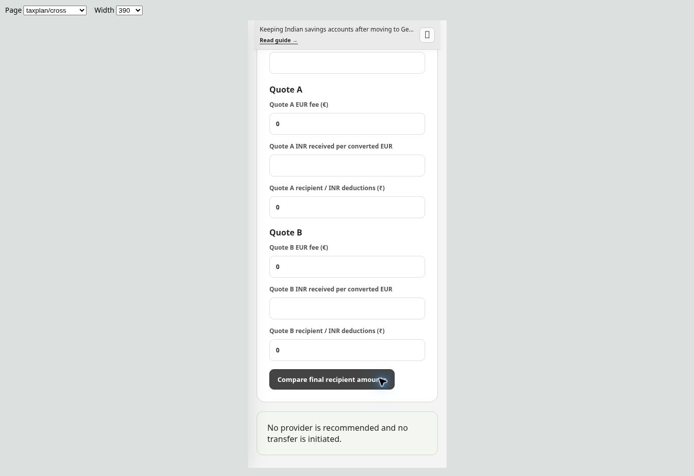

# Layout and spacing review — 14 November 2026

Owner requested a visual review and small spacing corrections, preserving the existing design.

## Findings and changes

- Transfer comparison controls had zero vertical separation from the next label and submit button. Stacked tax fields now have 14px gaps, the quote groups have 20px separation from the initial amount, and direct form actions have 16px clearance. Tax form source notes have 14px clearance from the preceding input grid.
- Investment jump buttons positioned sections 20px from the viewport top, underneath the 132px desktop sticky bars. Investment, news and immigration jump targets now clear the bars: 148px desktop, 88px mobile.
- Long insurer select options forced the health comparison form beyond its container (396px document width inside a 305px mobile content viewport; 931px inside an 885px tablet viewport). Allowing field containers to shrink removes the page overflow while preserving the locally scrollable comparison table.

## Verification

- Live homepage, tax companion and budget visually inspected before changes. Responsive preview used the current repository source and unchanged functionality.
- Self-filing, work worksheet, salary, budget, health comparison and feedback checked at 320, 390, 900 and 1348px iframe widths. Document scroll width equals available viewport width after correction (305, 375, 885 and 1333px excluding the scrollbar).
- Transfer form checked at the same four widths: stacked quote fields have 14px clearance, final action 16px; no document overflow.
- Investment goal jump checked at 900px: target starts at 148px, below the sticky bar ending at 132px. At 320px: target starts at approximately 88px, below the 58px mobile notice bar.
- Existing **156 tests pass**. Asset versions match and `git diff --check` passes. Changes are CSS plus the refreshed stylesheet/build references; no calculation or data-storage changes.
- Browser viewport checks are not physical-device, screen-reader, security or full-site regression certification. Scheduled audits remain pending.

Public deployment and live verification follow this combined release. The previous main head `6218bd5a8f7511c15b4a075db771975214d9af50` had successful Pages run `43603792779` before release preparation.
