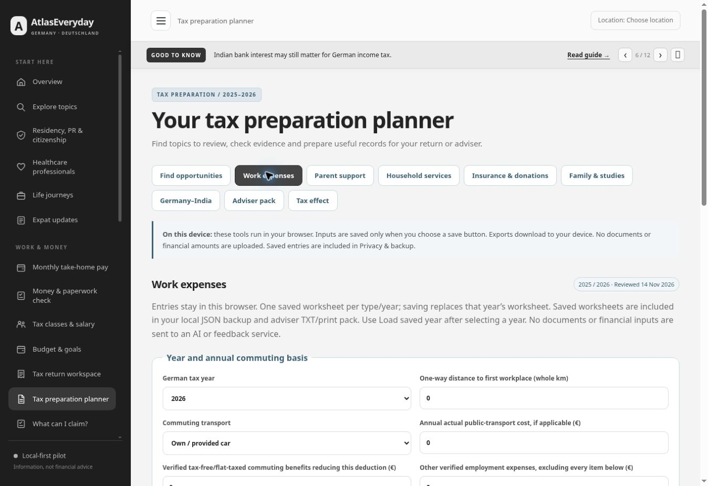

# Work expenses, parent support and household services — 14 November 2026

Owner-selected pending tasks **5, 7 and 8** (TS02–TS03, TS05 and TS06). Implementation, focused validation, publication and live verification are complete. The owner checklist is marked complete for these three bounded tasks. TS04 relocation/double-household work, the wider Sunday audit, authenticated Cloudflare checks, Friday security and 22 November hosting review retain their separate status.

## Implemented experience

- `#taxplan/work`: dated office/home/domestic business-travel records; overlap rejection; 2025/2026 distance parameters; transport cap/actual-public-cost comparison; reducing benefits; domestic meal/provided-meal rules; reimbursements; equipment work share, full-asset net threshold and month-based straight-line depreciation; qualifying computer one-year treatment; phone/internet work share; initial/subsequent/employment education.
- `#taxplan/parents`: one parent or two married parents sharing a household/period; actual need/evidence/work-capacity checks; recipient income/assets/grants; all shared-pot household members; country/month-adjusted limits; dated bank transfers; other German-tax donors; donor affordability. India uses the BMF quarter group. The first positive payment cannot cover earlier months.
- `#taxplan/household`: separate invoice/statement items; labour/materials; provider bank-payment and certificate evidence; reimbursements; duplicate references and portions claimed elsewhere; service versus craft-work credit limits; household-limit allocation and already-used credits; optional remaining assessed tax. Materials, cash/unverified/excluded items and subsidised/uncertain craft measures contribute no credit.

The three tabs are in the existing tax planner, with links from the opportunity finder and relevant expense/support/household guides. The existing colours and responsive cards are retained. No new service, transaction, document upload or filing is added.

Only explicit Save stores a worksheet. Snapshots are separate by type and year, survive normal reload, and are included in JSON backup and the selected-year adviser TXT/print pack. Each worksheet also has its own TXT download. Changing inputs invalidates old results and disables save/download until a new calculation. Saving does not create an expense; worksheets and expense records can overlap and must not be added together.

## Verified legal/rule sources

Reviewed **14 November 2026**, using enacted law and primary German tax-administration material. Historical 2025 parent-support examples are retained as independent references, rather than silently using a 2026 ceiling.

| Rule | Primary reference |
|---|---|
| Employment expenses, 2026 €0.38/km, transport cap, domestic meals/three-month limit, education | [EStG §9](https://www.gesetze-im-internet.de/estg/__9.html) |
| Historical €0.30 first 20 km / €0.38 thereafter; 2026 amendment | [BMF distance guidance](https://amtliche-handbuecher.bundesfinanzministerium.de/lsth/2026/B-Anhaenge/Anhang-14/inhalt.html) |
| Home-working €6/day, €1,260 cap and exclusions | [EStG §4](https://www.gesetze-im-internet.de/estg/__4.html) and [2026 BMF home-working guidance](https://usth.bundesfinanzministerium.de/lsth/2026/B-Anhaenge/Anhang-19/I/anhang-19-I.html) |
| Domestic own-car business travel €0.30/km | [BMF travel guidance](https://ao.bundesfinanzministerium.de/lsth/2026/B-Anhaenge/Anhang-25/III/inhalt.html) |
| €800 net full-asset threshold and depreciation | [EStG §6](https://www.gesetze-im-internet.de/estg/__6.html), [§7](https://www.gesetze-im-internet.de/estg/__7.html), [official work-equipment help](https://www.faq.elster.de/elsterweb/helpGlobal?themaGlobal=help_est_ufa_10_2023) |
| Qualifying computer hardware/software one-year life and accepted full purchase-year treatment | [BMF 22 February 2022](https://lsth.bundesfinanzministerium.de/esth/2022/C-Anhaenge/Anhang-01/V/anhang-1-V.html) |
| Initial education and annual employee allowance | [EStG §10](https://www.gesetze-im-internet.de/estg/__10.html), [§9a](https://www.gesetze-im-internet.de/estg/__9a.html) |
| Maintenance ceiling, income/grants, donor sharing, conversion, transfers and months | [EStG §33a](https://www.gesetze-im-internet.de/estg/__33a.html), [§32a](https://www.gesetze-im-internet.de/estg/__32a.html) |
| Shared-pot allocation, bank receipts, payment timing, income costs and examples | [BMF 15 October 2025 foreign-support letter](https://www.bundesfinanzministerium.de/Content/DE/Downloads/BMF_Schreiben/Steuerarten/Einkommensteuer/2025-10-15-ausland-hinweise-unterhaltsaufw.pdf?__blob=publicationFile&v=4) |
| India quarter group, effective from 2025 | [BMF 2 December 2025 country table, page 2](https://www.bundesfinanzministerium.de/Content/DE/Downloads/BMF_Schreiben/Steuerarten/Einkommensteuer/2025-12-02-beruecks-auslaendischer-verhaeltnisse.pdf?__blob=publicationFile&v=4) |
| Usual €15,500 chargeable-assets threshold and need | [BMF EStH §33a/R33a.1](https://amtliche-handbuecher.bundesfinanzministerium.de/esth/2025/A-Einkommensteuergesetz/IV-Tarif-31-34b/Paragraf-33a/paragraf-33a.html) |
| Disposable-income calculation and Opfergrenze | [BMF general maintenance guidance, 15 October 2025](https://esth.bundesfinanzministerium.de/esth/2025/B-Anhaenge/Anhang-03/II/anhang-3-II.html) |
| Separate service/craft direct credits, invoice/bank conditions and exclusions | [EStG §35a](https://www.gesetze-im-internet.de/estg/__35a.html), [Baden-Württemberg tax authority explanation](https://finanzamt-bw.fv-bwl.de/site/pbs-bw-mlr-root/node/5267631/Lde/index.html) |

## Independent references and checks

**140 tests pass**, comprising the previous 91 plus 49 new worksheet checks. Expected numbers are fixed values from published examples or separately worked arithmetic; tests do not generate expected results using the model itself.

| Example | Expected result |
|---|---|
| Ten office visits, 30 one-way km | €98 in 2025; €114 in 2026 |
| €1,200 ordinary equipment bought in October, verified three-year life | €100 first-year amount |
| €952 gross / 19% VAT, 50% work use | €800 full net threshold met; €476 professional amount |
| Domestic trip: 100 km, €20 other costs, €14 meal, free breakfast, €10 reimbursement | €48.40 |
| BMF foreign-support example 9: July 2025 €7,000 payment, full country group | €6,048 month-limited candidate |
| BMF example 6: December 2025 €3,000 advance | €1,008 maximum in 2025; no next-year amount from the payment |
| BMF example 8: three-quarter group, February/November support €3,200 | €3,200 within the €8,316 period ceiling |
| BMF example 12: two parents, April–December 2025, reviewed income €750 + €868 | €13,608 ceiling; €702 allowance; €916 income reduction; actual €1,500 is lower |
| BMF example 13 affordability: €16,450 net and 10 family percentage points | 22% = €3,619 |
| India 2026, one parent, full-year zero income and €6,000 paid | €3,087 before verified eligibility/affordability conditions |
| Two married India parents, €1,000 combined reviewed income, €6,000 paid | €6,174 ceiling less €688 income reduction = €5,486 |
| €1,200 household invoice, €1,000 labour, €200 material | €200 potential direct credit; €70 applied if only €70 assessed tax remains |

Boundary tests also cover invalid/mixed-year dates, missing numeric data, duplicate days/references, caps, reimbursements, meal reductions, work/personal shares, elapsed equipment lives, missing evidence, asset threshold, all household members, German versus other donors, high income, grants, partial support, zero affordability, household limit sharing, excluded/subsidised items, year-filtered adviser export and malformed saved summaries.

## Numerical limits

These are preparation/screening tools, not eligibility certificates or full tax assessments. Only 2025/2026 are modelled. Work expenses cover one employee, one consistent commuting mode and one day classification per date. Split-day exceptions, foreign travel, special disability cases, paid contributions to provided meals, long-term accommodation limits, unusual depreciation, changed/disposed assets and changing work use need separate review. Phone/internet uses an evidenced share, not an automatic flat allowance. General language learning receives review rather than an automatic deduction.

Parent income is a reviewed German-law amount **for the support period**, after appropriate costs; the tool does not assume a gross foreign pension is net income or subtract a universal €180 from everything. Currency conversion, need, work obligations and exemptions require evidence. Two-recipient pooling applies only to married parents with the same household/period. Other unlimited-German-tax donors share the ceiling; other donor support belongs in recipient receipts. A verified standard donor-affordability calculation is required; special benefit households, health/care additions, changing circumstances and business-income issues need separate review. The usual asset threshold is not country-reduced. Month-adjusted statutory amounts round up to whole euros.

Household credits cover supported EU/EEA services and eligible craft work in an existing household. The user must establish their cost/annual-limit share and service-charge payment/statement year. Mini-job employment, new-build, care-facility and other special classifications are not assessed. Sufficient remaining assessed income tax limits any applied credit; no refund or carryforward is calculated. Initial education, employment deductions, maintenance deductions and direct credits remain separate.

## Browser verification

Local browser checks have verified the combined work example (€2,045.80 employment candidate and separate €6,000 initial education), overlap rejection, invalidation/save controls, reload persistence, one/two-parent and December examples, missing-evidence review, distinct 2025/2026 saved inputs, household invoice/cap/tax-liability examples and cash/subsidy exclusion.

Downloaded worksheet TXT, adviser TXT and JSON backup were read back. They contain the correct snapshots/year; the expense ledger remains empty in the synthetic test session. Test exports are private QA artifacts and are not committed. Responsive browser previews at 320, 390 and 900 CSS pixels show no document overflow or overflowing form controls across all three worksheets. The mobile section navigation uses a single horizontally scrollable row and keeps the active section visible. A 320px household calculation reproduced the desktop result and focused its named result region. Desktop guide-to-worksheet links were also exercised. These are Chrome/iframe checks, not physical-device or full screen-reader certification. The published examples and existing planner sections were subsequently checked as recorded below.

## Publication and live evidence

- Feature commit [`db09964c06de7bfaebff0900b41e2b2132829047`](https://github.com/nikunjsb/Finbridge/commit/db09964c06de7bfaebff0900b41e2b2132829047).
- [Pages run 43583872978](https://github.com/nikunjsb/Finbridge/actions/runs/43583872978) completed successfully. Deploy finished **10:09:34 UTC / 11:09:34 CET**, 14 November 2026.
- A normal public reload served **build `3350150dd886`**, **app `7b362ca58cd9`**, **CSS `ebaf95602244`**. No page cache-busting query was used.
- Live work example: one 2026 office visit at 30 one-way km produced **€11.40**, with **€0 additional amount above the employee allowance**.
- Live parent example: one India parent, full year, zero reviewed income and €6,000 of verified support produced **€3,087** before the selected verified conditions; the example's donor affordability did not bind.
- Live household example: €1,200 cost share, €1,000 labour, €200 material produced **€200 potential direct credit**, limited to **€70** against entered remaining assessed tax.
- All six existing planner sections (finder, insurance/donations, family/studies, Germany–India, adviser pack and tax effect) still rendered their expected controls. Their existing numerical tests remain green.
- No synthetic live worksheet was saved or sent to a backend. The final screenshot shows the default work worksheet and the three new navigation entries, without personal financial records.

